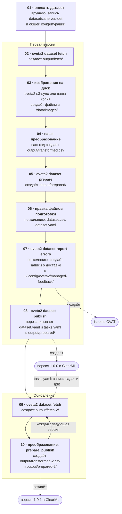
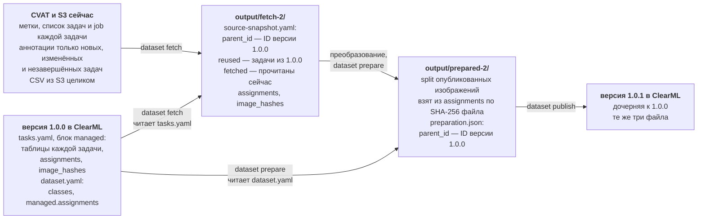

# Управляемый датасет: полный цикл и файлы

Страница проводит управляемый датасет ([managed dataset](../GLOSSARY.md)) через десять шагов: от записи в общей конфигурации ([global configuration](../GLOSSARY.md)) до первой версии в ClearML и дальше через обновление, которое начинается со второго `dataset fetch`. Для каждого шага перечислены все каталоги, которые он использует, и все файлы в них.

Правила проверок, флаги и сообщения об ошибках описаны в [dataset](commands/dataset.md). Здесь — только порядок шагов и то, что каждый шаг читает и пишет.

Пример тот же, что на остальных страницах: датасет `shelves-det` с источником ([source](../GLOSSARY.md)) CVAT `cvat` (ключ `shelves` в разделе `projects`, ID `123`; в CVAT этот проект называется `Retail shelves`) и источником `extra` типа `s3-csv`, назначение в ClearML — проект `Retail/Datasets`. Рабочие каталоги лежат в `output/`, кэш изображений ([image cache](../GLOSSARY.md)) — в `~/data/images`.

## Весь путь



Сплошные стрелки — порядок шагов, пунктирные — то, что появляется вне этой машины. Шаги 02–08 дают первую версию. Шаг 09 — обновление: это та же команда, что на шаге 02, но теперь в ClearML есть управляемая версия, на которую можно опереться. Для каждой следующей версии повторяются шаги 09 и 10. Номера версий назначает ClearML; `1.0.0` и `1.0.1` здесь — пример.

`dataset fetch` и `dataset prepare` каждый раз пишут новый каталог и отказываются писать в существующий, поэтому обновление — это второй набор каталогов рядом с первым. На месте перезаписываются только две вещи: `publish` заменяет `dataset.yaml` и `tasks.yaml` в каталоге подготовки, а `report-errors` и `publish` обновляют файл записей о доставке замечаний ([feedback receipt](../GLOSSARY.md)).

## Каталоги по шагам

Обозначения в этой таблице и в таблицах шагов:

| Пометка | Значение |
|---|---|
| создаётся | Шаг создаёт файл или каталог. |
| перезаписывается | Шаг заменяет существующий файл. |
| читается | Шаг читает файл или каталог. |
| временный | Появляется на время работы команды и удаляется до её завершения. |
| правите вы | Файл пишете или правите вы, а не cveta2. |
| если есть | Шаг делает это, только если выполнено условие из третьего столбца. Если пометка стоит одна, там же сказано, что делает шаг. |
| если готово | Только если у подготовки нет блокирующих условий. |
| не используется | Шаг не читает и не пишет этот файл или каталог; его может и не быть. |
| — | В таблице «Каталоги по шагам»: шаг к этому месту не обращается. |

| Где | 01 описать | 02 fetch | 03 изображения | 04 преобразование | 05 prepare | 06 правка | 07 report-errors | 08 publish | 09 fetch ещё раз | 10 следующая версия |
|---|---|---|---|---|---|---|---|---|---|---|
| **На этой машине** | | | | | | | | | | |
| Файл общей конфигурации | правите вы | читается | читается | — | читается | — | читается | читается | читается | читается |
| Личный `config.yaml` | читается | читается | читается | — | читается | — | читается | читается | читается | читается |
| `managed-feedback/` рядом с ним | — | — | — | — | — | — | создаётся, перезаписывается | создаётся, перезаписывается | — | создаётся, перезаписывается |
| Корни изображений, `~/data/images/` | — | — | создаётся | читается | читается | — | — | читается | — | создаётся, читается |
| `output/fetch/` | — | создаётся | — | читается | читается | — | — | — | — | — |
| `output/transformed.csv` | — | — | — | создаётся | читается | — | — | — | — | — |
| `output/prepared/` | — | — | — | — | создаётся | правите вы | читается | читается, перезаписывается | — | читается (`dataset diff`, по желанию) |
| `output/fetch-2/`, `output/transformed-2.csv`, `output/prepared-2/` | — | — | — | — | — | — | — | — | создаётся | создаётся, читается, перезаписывается |
| Копия в системном временном каталоге | — | — | — | — | — | — | — | временный | — | временный |
| Кэш ClearML SDK | — | — | — | — | — | — | — | — | создаётся | читается |
| **Удалённо** | | | | | | | | | | |
| Версии в ClearML | читается | читается | — | — | читается | — | читается | читается, создаётся | читается | читается, создаётся |
| CVAT | — | читается | читается | — | читается, если есть | — | читается, создаётся | читается, создаётся | читается | читается, создаётся |
| S3 | — | читается | читается | — | читается | — | читается | читается | читается | читается |
| API классов | — | читается | — | — | читается | — | — | читается | читается | читается |

Примечания к таблице:

- Кэша аннотаций ([annotation cache](../GLOSSARY.md)) `~/.cache/cveta2/task_annotations/` в таблице нет: `dataset fetch` читает CVAT напрямую и этот кэш не использует.
- На шаге 01 к ClearML обращается только `dataset show`.
- Строка «Кэш ClearML SDK» показана для нового датасета. Если в ClearML уже есть версии без управляемых метаданных, шаги 01, 02, 05, 07 и 08 тоже пишут в этот кэш: запись о последней версии, а если в версии есть `dataset.yaml`, то и её копию.
- Файлы записей в `managed-feedback/` появляются, только если есть замечания для доставки или старый `feedback.json`.
- На шаге 05 `dataset prepare` обращается к CVAT, только если в личной конфигурации хотя бы один путь изображений (`image_cache` или `cache.projects`) записан по имени проекта в CVAT (например, `image_cache.Retail shelves`), а не по ключу из `projects`: тогда он читает список проектов, чтобы сопоставить имена с ID.
- В CVAT шаги 07, 08 и 10 создают только issue.

## 01. Описать датасет

```bash
cveta2 dataset list               # печатает все записи datasets, без обращения в сеть
cveta2 dataset show shelves-det   # запись и последняя версия в ClearML, или null
```

Управляемый датасет существует, как только в общей конфигурации есть его запись. Команды, которая её создаёт, нет: запись пишут вручную в файл, общий для команды. Две команды выше только читают её. Ключи записи — в [описании датасета](commands/dataset.md#описание-датасета-в-общей-конфигурации).

Подключение ClearML SDK и доступ к S3 настраиваются вне cveta2. ClearML читает свой `clearml.conf` или переменные окружения; через его же настройки хранилища идёт проверка корней `s3_roots`. Источник `s3-csv` читается с обычной цепочкой учётных данных S3. Проверить настройку можно командой [doctor](commands/doctor.md).

| Путь | На этом шаге | Что в нём и как шаг его использует |
|---|---|---|
| **Общая конфигурация** | | Один файл, выбранный через `--global-config`, `CVETA2_GLOBAL_CONFIG` или ключ `global_config` личной конфигурации. |
| `<файл>.yaml` | правите вы | Вы добавляете `datasets.shelves-det`: `sources`, `clearml.project` и `clearml.dataset`, `api_url` и, если нужно, `clearml.output_uri`, `s3_roots`, `empty_classes`, `overlaps`. Источник `cvat` ссылается на ключ из `projects`, поэтому `projects.shelves.id` тоже должен быть. Ни одна команда cveta2 не меняет значения в разделе `datasets`. Команды, которые записывают общий файл (например, `setup --global` и `ignore`), переписывают его целиком, вместе с этим разделом: значения записи сохраняются, но комментарии и оформление YAML пропадают, а незаданные ключи появляются со значениями по умолчанию. |
| `.<имя файла>.lock` | не используется | Блокировка, которую берут команды, перезаписывающие общий файл, например `setup --global`. Команды `dataset` файл только читают и блокировку не берут. |
| **`~/.config/cveta2/`** | | Каталог личной конфигурации ([personal configuration](../GLOSSARY.md)). Это место по умолчанию; `--config` и `CVETA2_CONFIG` его меняют. |
| `config.yaml` | читается | Логин и пароль CVAT, `global_config` и локальные пути изображений: `cache.images_root`, `cache.projects`, `image_cache`. |
| `projects.yaml` | не используется | Кэш списка проектов CVAT. Его пишут другие команды cveta2, а не команды `dataset`. |
| `managed-feedback/` | не используется | Каталога ещё нет. Его создаст шаг 07 или 08 при первой попытке доставить замечание; если доставлять нечего, каталог не появится. |

## 02. Первая выгрузка

```bash
cveta2 dataset fetch shelves-det --output-dir output/fetch
```

Команда загружает реестр классов ([class registry](../GLOSSARY.md)) с `api_url` и ищет последнюю версию датасета в ClearML. Управляемой версии нет, поэтому каждый источник CVAT читается целиком: метки, список задач и у каждой задачи — job, кадры, аннотации, issue. CSV из S3 скачивается целиком. Задачи из списка игнорируемых задач ([ignore list](../GLOSSARY.md)) проекта пропускаются.

Команда ничего не пишет в CVAT, S3 и ClearML и не скачивает изображения. Подробнее — [fetch](commands/dataset.md#fetch).

| Путь | На этом шаге | Что в нём и как шаг его использует |
|---|---|---|
| **Общая конфигурация** | | |
| `<файл>.yaml` | читается | Запись датасета, `cvat.host` и `cvat.organization`, `projects.shelves.id` и список игнорируемых задач проекта. |
| **`~/.config/cveta2/`** | | |
| `config.yaml` | читается | Логин и пароль CVAT, настройки сети. |
| **`output/`** | | Каталог, в котором создаётся `--output-dir`; если его нет, команда создаёт и его. |
| `.cveta2-source-XXXXXXXX/` | временный | Сюда всё пишется сначала. Затем в `output/fetch/` создаются жёсткие ссылки на эти файлы, и каталог удаляется. |
| **`output/fetch/`** | | Каталог выгрузки управляемого датасета ([managed fetch](../GLOSSARY.md)). Он не должен существовать; это проверяется только после того, как прочитаны все источники. |
| `dataset.csv` | создаётся | Строки `dataset.csv` всех источников подряд и пять столбцов происхождения: `source_id`, `source_project_id`, `source_task_id`, `source_frame_id`, `source_row_id`. У строк из CVAT `image_path` пустой. |
| `source-snapshot.yaml` | создаётся | Снимок источников ([source snapshot](../GLOSSARY.md)). Записи реестра классов и их хеш; адрес и организация CVAT; у каждого источника CVAT — метки и по каждой задаче `updated_date`, `completed` и её строки как текст CSV; у источника `s3-csv` — адрес, SHA-256, ETag и ID версии объекта; списки `fetched` и `reused`; список `skipped` есть, только если были задачи без данных ([task without data](../GLOSSARY.md)). `parent_id` — ID последней версии в ClearML, управляемой или нет; здесь он `null`, потому что версий нет. `assignments` и `image_hashes` пусты. |
| `sources/cvat/` | создаётся | По каталогу на источник, имя берётся из `sources[].name`. |
| `sources/cvat/dataset.csv` | создаётся | Строки последней завершённой задачи ([completed task](../GLOSSARY.md)) каждого изображения. |
| `sources/cvat/obsolete.csv` | создаётся | Строки, которые перекрыла более новая завершённая задача, и строки удалённых изображений. |
| `sources/cvat/in_progress.csv` | создаётся | Строки в работе ([in progress](../GLOSSARY.md)): строки незавершённых задач. |
| `sources/cvat/deleted.csv` | создаётся | По одной строке на удалённое изображение. |
| `sources/extra/` | создаётся | Источник `s3-csv`. |
| `sources/extra/dataset.csv` | создаётся | Объект S3 в том виде, в каком он прочитан. |
| `sources/extra/obsolete.csv`, `in_progress.csv`, `deleted.csv` | создаётся | Только строка заголовка. |
| **`<кэш ClearML>/storage_manager/datasets/`** | | Собственный кэш ClearML SDK. |
| `<ID версии>.state.json` | если есть | Собственная запись ClearML о версии. Ничего, если у датасета в ClearML нет версий. Если версия есть, файл появляется, как только команда её открывает. |
| `ds_<ID версии>_<хеш>/` | если есть | Копия последней версии. Появляется, только если в версии есть `dataset.yaml`: ClearML скачивает фрагмент (chunk) архива версии, в котором лежит этот файл, и распаковывает его целиком. У небольшой версии фрагмент один, и это весь архив. Без блока `managed` в `dataset.yaml` из этой версии больше ничего не берётся. |

Точный состав четырёх таблиц источника описан в [формате данных](dataset-format.md#файлы-полной-выгрузки).

## 03. Изображения на диск

```bash
cveta2 s3-sync -p "Retail shelves"
```

Шаг 05 считает SHA-256 каждого изображения и открывает его, поэтому файлы должны лежать на этой машине, внутри разрешённого локального корня, ещё до преобразования. Разрешённые корни — `cache.images_root` и каталог кэша изображений каждого проекта-источника. Кэш изображений проекта CVAT заполняет [s3-sync](commands/s3-sync.md); обычный `cveta2 fetch` проекта тоже его заполняет. Шаг можно выполнить в любой момент до шага 04.

Как выбирается каталог проекта и как ключи S3 превращаются в локальные пути — в [images-and-cache.md](images-and-cache.md).

| Путь | На этом шаге | Что в нём и как шаг его использует |
|---|---|---|
| **Общая конфигурация** | | |
| `<файл>.yaml` | читается | Корень синхронизации ([sync root](../GLOSSARY.md)) `projects.<ключ>.sync_root` и отбрасываемый префикс ([ignored prefix](../GLOSSARY.md)) `ignored_prefix`: они задают префикс в S3 и то, как ключи становятся локальными путями. |
| **`~/.config/cveta2/`** | | |
| `config.yaml` | читается | Где лежит кэш изображений проекта: `image_cache.<проект>`, иначе `<корень>/<имя проекта>`, где корень — `cache.projects.<проект>.images_root`, а если его нет, `cache.images_root`. |
| **`~/data/images/`** | | В этом примере — `cache.images_root`. Любой файл под ним лежит внутри разрешённого локального корня. |
| `<каталог проекта>/` | создаётся | Кэш изображений проекта CVAT. |
| `<каталог проекта>/2026-02/shelf_0009.jpg` | создаётся | По файлу на объект S3; путь — ключ S3 без отброшенного префикса. Файл, который уже есть на диске, повторно не скачивается. |
| `<каталог проекта>/.cveta2_cache/` | если есть | Появляется, когда общий кэш аннотаций лежит под тем же префиксом S3: `s3-sync` скачивает и эти объекты. |
| `<ваш каталог>/extra-3.png` | правите вы | Изображения источника `s3-csv`. cveta2 их не скачивает: положите их под разрешённый локальный корень сами. |

## 04. Ваше преобразование

```bash
python transform.py output/fetch/dataset.csv ~/data/images output/transformed.csv
```

cveta2 не проверяет, как получен преобразованный CSV ([transformed CSV](../GLOSSARY.md)), а проверяет только его содержимое. Split — ваш: cveta2 никогда не назначает его сам, он только сохраняет split изображения, которое уже опубликовано. В первом цикле ни одно изображение ещё не опубликовано, поэтому весь split берётся из этого файла.

Пример `transform.py` — в [сценариях работы](workflows.md#управляемый-датасет), требования к файлу — в [prepare](commands/dataset.md#что-должен-содержать-преобразованный-csv).

| Путь | На этом шаге | Что в нём и как шаг его использует |
|---|---|---|
| **`output/fetch/`** | | Каталог выгрузки управляемого датасета. |
| `dataset.csv` | читается | Вход вашего кода. Сохраните столбцы `source_*`: по ним замечания попадают в CVAT, а решениям о пересечении ([overlap decision](../GLOSSARY.md)) нужен `source_id`. |
| **`~/data/images/`** | | Корни изображений. |
| `**/*` | читается | Ваш код ищет файлы, чтобы заполнить `image_path`. |
| **`output/`** | | Любое место на ваш выбор: на этом шаге cveta2 не запускается. |
| `transformed.csv` | создаётся | Пишет ваш код. Уникальные непустые имена столбцов; `image_name`, `image_path`, `instance_label` и четыре столбца `bbox_*`. `image_path` — абсолютный путь к файлу внутри разрешённого локального корня. `split` заполняете вы для каждого изображения, которого нет ни в одной опубликованной версии. |

## 05. Управляемая подготовка

```bash
cveta2 dataset prepare shelves-det output/transformed.csv \
  --source output/fetch --output-dir output/prepared
```

Управляемая подготовка ([managed preparation](../GLOSSARY.md)) загружает реестр классов и последнюю версию в ClearML, читает ваш CSV и снимок источников, проверяет корни изображений, считает SHA-256 каждого изображения, применяет решения о пересечении, переносит опубликованный split (в первом цикле его нет), проверяет строки и изображения по профилю `clearml-yolo` и собирает замечания к кадрам ([feedback finding](../GLOSSARY.md)). Каталог пишется в самом конце, поэтому остановка до записи не оставляет ничего. Если прервётся сама запись, в каталоге может не оказаться `preparation.json`: `report-errors` и `publish` такой каталог не примут. Подробнее — [prepare](commands/dataset.md#prepare).

Какой получится первая версия, зависит от того, что уже есть в ClearML:

| Что в ClearML | Что делать | Что записано в `preparation.json` и что сделает `publish` |
|---|---|---|
| У датасета нет ни одной версии | `prepare` без флагов. Родительского датасета ([parent dataset](../GLOSSARY.md)) нет, весь split берётся из вашего CSV. | `parent_id: null`, `first: false`. `publish` создаст версию без родителя. |
| Есть версии без управляемых метаданных: их опубликовали через `upload-dataset` или вручную, и в их `dataset.yaml` нет блока `managed` | `prepare --first`. Без флага команда останавливается с `Parent <id> is not a managed dataset version; start a managed lineage with dataset prepare --first`. С флагом из этой версии не берётся ничего. | `parent_id` — ID этой версии, `first: true`. `publish` всё равно создаст версию без родителя: так начинается управляемая история ([managed lineage](../GLOSSARY.md)). |

Команда завершается одним из трёх способов:

| Итог | Код | Что в каталоге подготовки |
|---|---|---|
| Ошибка: конфигурация, сеть, новая версия в ClearML после выгрузки, нет решения о пересечении, изображение вне разрешённых корней, каталог уже существует | `2` | Каталог не создаётся. |
| Есть блокирующие условия ([blocker](../GLOSSARY.md)): `ready` равен `false`, причины — в `blockers` в `report.json`: структурные ошибки CSV; не осталось ни одного годного изображения; нужна очистка, а передан `--no-clean`; у класса, который не исключён, нет bbox; одно изображение в нескольких split | `1` | Пять файлов: `transformed.csv`, `source-snapshot.yaml`, `report.json`, `broken-images.csv`, `preparation.json`. `report-errors` с таким каталогом работает, `publish` от него отказывается. |
| Готово: очистка убрала отклонённые строки и применила исправления; в `pending` могут остаться условия split, которые потребует `publish` | `0` | Восемь файлов: те же пять и `dataset.csv`, `dataset.yaml`, `tasks.yaml`. |

| Путь | На этом шаге | Что в нём и как шаг его использует |
|---|---|---|
| **Общая конфигурация** | | |
| `<файл>.yaml` | читается | Запись датасета: `api_url`, `s3_roots`, `empty_classes`, `overlaps`, `clearml`; записи раздела `projects`, на которые ссылаются её источники. |
| **`~/.config/cveta2/`** | | |
| `config.yaml` | читается | Разрешённые локальные корни: `cache.images_root` и для каждого проекта-источника `image_cache.<проект>` и `cache.projects.<проект>.images_root`. |
| **`output/`** | | Ваш преобразованный CSV и временный каталог рядом с каталогом подготовки. |
| `transformed.csv` | читается | Читается один раз как байты; эти же байты копируются в каталог подготовки. |
| `.cveta2-managed-XXXXXXXX/` | временный | Сюда пишутся файлы подготовки. Затем в `output/prepared/` создаются жёсткие ссылки на них, и каталог удаляется. |
| **`output/fetch/`** | | Передан как `--source`. |
| `source-snapshot.yaml` | читается | Читается один раз как байты и копируется. Его `parent_id` должен совпадать с последней версией в ClearML, иначе команда останавливается. |
| `dataset.csv` | не используется | Не читается: из этого каталога берётся только снимок. |
| `sources/` | не используется | Не читается: те же таблицы лежат внутри снимка. |
| **`~/data/images/`** | | Корни изображений. |
| `<каждый image_path>` | читается | Каждый файл читается целиком ради SHA-256 и открывается для проверки формата и размера. Путь вне разрешённых корней останавливает команду до того, как открыт хотя бы один файл. |
| **`output/prepared/`** | | Каталог подготовки — подготовленный датасет ([prepared bundle](../GLOSSARY.md)). Он не должен существовать и не должен лежать внутри `output/fetch/`. |
| `transformed.csv` | создаётся | Точная копия вашего CSV. |
| `source-snapshot.yaml` | создаётся | Точная копия снимка источников. |
| `report.json` | создаётся | Отчёт проверки ([verification report](../GLOSSARY.md)): ключи проверки строк `profile`, `is_valid`, `requires_cleanup`, `structural_errors`, `counts`, `clean_row_positions`, `broken_row_positions`, `checked_checks`, `skipped_checks`, `issues` и ключи подготовки `ready`, `blockers`, `pending`, `missing_classes`, `split_collisions`, `broken_image_rows`, `mapped_findings`, `unmapped_errors`, `split_replacements`. |
| `broken-images.csv` | создаётся | Все строки каждого изображения, у которого есть отклонённая строка. |
| `dataset.csv` | создаётся, если готово | Очищенные строки: после решений о пересечении, переноса опубликованного split и очистки. |
| `dataset.yaml` | создаётся, если готово | `api_url`, `classes` с `prod_id`, `empty`, `alt_names`, `images.local_root`, `images.s3_root` и блок `managed`: имя датасета, копия его записи, сервер CVAT и `assignments` (SHA-256 изображения → split). |
| `tasks.yaml` | создаётся, если готово | Список задач датасета ([task manifest](../GLOSSARY.md)): `included`, `obsolete` и блок `managed` — снимок источников с `assignments`, `image_hashes` и `parent_id`. |
| `preparation.json` | создаётся | Пишется последним. `format_version: 3`, `name`, `parent_id`, `parent_version`, `findings`, `ready`, `clean`, `first`. |
| **`<кэш ClearML>/storage_manager/datasets/`** | | Собственный кэш ClearML SDK. |
| `<ID версии>.state.json`, `ds_<ID версии>_<хеш>/` | если есть | Как на шаге 02: ничего, если версий нет. С `--first` `dataset.yaml` последней версии нужен только для того, чтобы убедиться, что в нём нет блока `managed`. |

Содержимое файлов каталога — в [формате данных](dataset-format.md#dataset-prepare).

## 06. Правка файлов подготовки

Шаг необязательный. У подготовленного датасета нет контрольных сумм: между `prepare` и `publish` файлы можно править, и `publish` проверит то, что в них есть в этот момент. Обычная правка — заполнить пустой `split` в `dataset.csv`. Строка в `pending` (`заполните split у <N> изображений в output/prepared/dataset.csv`) называет только число таких изображений; сами изображения ищите по пустому `split`. Подробнее — [Что можно править](commands/dataset.md#что-можно-править).

| Путь | На этом шаге | Что в нём и как шаг его использует |
|---|---|---|
| **`output/prepared/`** | | Каталог подготовки. Следующие команды читают каждый файл таким, какой он в этот момент. |
| `dataset.csv` | правите вы | Заполняйте `split`, убирайте строки. `publish` оставляет строки как есть и проверяет их. |
| `dataset.yaml` | правите вы | Сохраняются как есть: `classes.<имя>.empty`, `api_url`, `images.local_root`, `images.s3_root`. `publish` строит блок `managed` заново. |
| `tasks.yaml` | не используется | `publish` строит его заново целиком, поэтому правка будет перезаписана. Но файл должен разбираться: иначе `report-errors` и `publish` остановятся. |
| `source-snapshot.yaml` | не используется | Не правьте. По его SHA-256 находится файл записей о доставке, поэтому после правки записи прежних отправок теряются. |
| `preparation.json` | не используется | Запись подготовки. Её `findings` — то, что доставляют шаги 07 и 08; с другим `format_version` каталог не читается. |
| `transformed.csv` | не используется | Копия вашего CSV. Шаги 07 и 08 разбирают его снова, поэтому он должен оставаться корректным CSV. |
| `report.json` | не используется | Отчёт проверки. Шаги 07 и 08 берут из него `unmapped_errors`. |
| `broken-images.csv` | не используется | Строки отклонённых изображений. Ни одна следующая команда этот файл не читает. |

## 07. Замечания в CVAT

```bash
cveta2 dataset report-errors output/prepared
```

Шаг необязательный: `publish` доставит замечания сам. Команда проверяет, что последняя версия в ClearML — та же, что записана при подготовке, сравнивает источники со снимком и создаёт по одному issue в CVAT на кадр с ошибками. Она работает и с каталогом, в котором подготовка заблокирована. В каталог подготовки она ничего не пишет: её единственный файл — файл записей о доставке замечаний ([feedback receipt](../GLOSSARY.md)) рядом с личной конфигурацией.

Замечание пропускается и учитывается в `skipped`, если его задача изменилась после выгрузки, если описание её источника в общей конфигурации отличается от снимка или если прерванную отправку замечания к этой задаче не удалось проверить в CVAT. Задача CVAT, завершённая после выгрузки, другой сервер CVAT или новая версия в ClearML останавливают команду. Подробнее — [report-errors](commands/dataset.md#report-errors).

| Путь | На этом шаге | Что в нём и как шаг его использует |
|---|---|---|
| **Общая конфигурация** | | |
| `<файл>.yaml` | читается | Запись датасета, сервер CVAT, проекты и их списки игнорируемых задач. |
| **`~/.config/cveta2/`** | | |
| `config.yaml` | читается | Логин и пароль CVAT, настройки сети. |
| `managed-feedback/` | создаётся | Создаётся вместе с первым файлом записей. |
| `managed-feedback/<SHA-256 source-snapshot.yaml>.json` | создаётся, перезаписывается | Записи о доставке замечаний всех подготовок, сделанных из этой выгрузки. `format_version: 1` и `receipts` — записи по метке замечания; у каждой записи поля `source_id`, `project_id`, `task_id`, `frame_id`, `marker`, `before_date`, `fingerprint`, `after_date`, `delivered`. Запись сохраняется до создания issue и отмечается доставленной после него, поэтому файл появляется при первой же попытке доставки, даже неудачной. Если доставлять нечего, файл не появляется. |
| `managed-feedback/.cveta2-feedback-XXXXXXXX` | временный | Каждое сохранение пишет временный файл и переименовывает его поверх файла записей. |
| **`output/prepared/`** | | Каталог подготовки. В него ничего не пишется. |
| `preparation.json` | читается | `name`, `parent_id`, `parent_version`, `first` и `findings`, которые нужно доставить. |
| `source-snapshot.yaml` | читается | Сравнивается с текущим состоянием CVAT и S3 и с текущей записью датасета. По его SHA-256 находится файл записей. |
| `transformed.csv` | читается | Разбирается вместе со снимком. |
| `report.json` | читается | `unmapped_errors` попадает в результат. |
| `dataset.csv`, `dataset.yaml`, `tasks.yaml` | читается, если есть | У заблокированной подготовки их нет, и команда всё равно работает. Если есть хотя бы один из них, все три должны существовать и разбираться без ошибок. |
| `broken-images.csv` | не используется | Не читается. |
| `feedback.json` | если есть | Файл записей от старой версии cveta2. Его записи копируются в общий файл, и тот создаётся, даже когда доставлять нечего; сам `feedback.json` остаётся. |
| **`<кэш ClearML>/storage_manager/datasets/`** | | Собственный кэш ClearML SDK. |
| `<ID версии>.state.json`, `ds_<ID версии>_<хеш>/` | если есть | Как на шаге 02: ничего, если версий нет. Команда только проверяет, что последняя версия — та же, что записана в `preparation.json`. |

## 08. Публикация первой версии

```bash
cveta2 dataset publish output/prepared
```

Публикация ([publication](../GLOSSARY.md)) выполняет те же проверки свежести, что и шаг 07, копирует три публикуемых файла в отдельный каталог и проверяет эту копию; список проверок — в [publish](commands/dataset.md#publish). Затем она заново строит служебные данные, доставляет замечания к кадрам, ещё раз проверяет источники и ClearML и загружает копию как новую финализированную версию.

`dataset.yaml` и `tasks.yaml` записываются обратно в каталог подготовки до доставки замечаний и до загрузки. Если команда остановится позже, эти файлы там уже перезаписаны. Если доставить замечание не удалось, новая версия не создаётся. Подробнее — [publish](commands/dataset.md#publish).

| Путь | На этом шаге | Что в нём и как шаг его использует |
|---|---|---|
| **Общая конфигурация** | | |
| `<файл>.yaml` | читается | Текущая запись датасета. Её ключи `clearml` задают назначение; копия записи попадает в `dataset.yaml`. |
| **`~/.config/cveta2/`** | | |
| `config.yaml` | читается | Логин и пароль CVAT, настройки сети. |
| `managed-feedback/<SHA-256>.json` | создаётся, перезаписывается | Тот же файл записей, что на шаге 07. Замечания, доставленные шагом 07, находятся в CVAT и считаются уже существующими. |
| **`<системный временный каталог>/cveta2-managed-publish-XXXXXXXX/`** | | Отдельная копия. Все проверки идут по ней, и публикуется она же. |
| `dataset.csv` | временный | Копируется из каталога подготовки после проверок свежести и до проверок содержимого. Правка каталога подготовки, сделанная после этого момента, в версию не попадёт. |
| `dataset.yaml` | временный | Копируется, затем перезаписывается с новым блоком `managed`. |
| `tasks.yaml` | временный | Копируется, затем перезаписывается целиком. |
| **`output/prepared/`** | | Каталог подготовки. |
| `dataset.csv` | читается | Должен существовать: заблокированная подготовка не публикуется. Строки публикуются как есть. |
| `dataset.yaml` | читается, перезаписывается | Блок `managed` строится заново из текущих строк и текущей записи датасета и записывается обратно сюда же. |
| `tasks.yaml` | читается, перезаписывается | Строится заново целиком и записывается обратно сюда же. |
| `.dataset.yaml.tmp`, `.tasks.yaml.tmp` | временный | Каждый из двух файлов заменяется одним переименованием. |
| `preparation.json` | читается | `name`, `parent_id`, `parent_version`, `first` и `findings`, которые нужно доставить. |
| `source-snapshot.yaml` | читается | Сравнивается с текущим состоянием CVAT и S3 и с текущей записью датасета. По его SHA-256 находится файл записей. |
| `transformed.csv` | читается | Разбирается вместе со снимком. |
| `report.json` | читается | `unmapped_errors` попадает в результат доставки замечаний. |
| `broken-images.csv` | не используется | Не читается. |
| `publication.json` | не используется | Не пишется никогда: этот файл пишет только `upload-dataset`. |
| **`~/data/images/`** | | Корни изображений из `dataset.yaml`. |
| `<каждый image_path>` | читается | SHA-256 считается и файл открывается заново, после проверки корней: каждый локальный корень существует, каждый корень S3 доступен для чтения списка объектов. |
| **`<кэш ClearML>/storage_manager/datasets/`** | | Собственный кэш ClearML SDK. |
| `<ID версии>.state.json`, `ds_<ID версии>_<хеш>/` | если есть | Ничего для первой версии нового датасета. Позже — родительская версия: опубликованный split берётся из её `dataset.yaml`. |
| **ClearML: `Retail/Datasets` / `shelves-det`** | | Новая финализированная версия из трёх файлов. Изображения в неё не загружаются: в `dataset.csv` остаются пути к ним. Номер назначает ClearML; файлы уходят в `clearml.output_uri`, если он задан в записи датасета. |
| `dataset.csv` | создаётся | Проверенные строки. |
| `dataset.yaml` | создаётся | С новым блоком `managed`: копия записи датасета, сервер CVAT, `assignments`. |
| `tasks.yaml` | создаётся | С блоком `managed`: весь снимок источников, `assignments`, `image_hashes`, `parent_id`. Этот файл читает шаг 09. |

## 09. Обновление: вторая выгрузка

```bash
cveta2 dataset fetch shelves-det --output-dir output/fetch-2
```

Вывод команды (сокращён: здесь нет полей `rows`, `excluded_class_rows` и `missing_classes`) показывает, что взято из прошлой версии:

```json
{
  "directory": "output/fetch-2",
  "parent_id": "<ID версии 1.0.0>",
  "sources": [
    {"name": "cvat", "fetched": [458], "reused": [457], "skipped": [], "content_hash": null},
    {"name": "extra", "fetched": [], "reused": [], "skipped": [], "content_hash": "<SHA-256 CSV>"}
  ]
}
```

Это та же команда, что на шаге 02. Изменился ClearML: последняя версия теперь управляемая, поэтому она становится родительским датасетом, а её `tasks.yaml` служит кэшем записей задач. По каждому источнику CVAT команда по-прежнему читает метки, список задач и job, а затем решает по каждой задаче:

| Что делает вторая выгрузка | С какими задачами или в каком случае |
|---|---|
| Берёт задачу из версии 1.0.0, не читая её аннотации | Задача была завершена в 1.0.0 и завершена сейчас, её `updated_date` не изменился, у источника то же имя, тот же тип и тот же ID проекта CVAT, метки проекта не менялись. |
| Читает заново все задачи всех источников | Передан `--refresh`; изменился реестр классов; изменился `cvat.host` или организация; в версии 1.0.0 снимок источников неполон или не сходится со своими хешами (например, её опубликовала старая версия cveta2). |
| Читает всегда | Незавершённые задачи, новые и изменённые задачи, CSV источника `s3-csv`. |
| Не включает | Задачи, которых больше нет в проекте, задачи из списка игнорируемых и задачи без данных ([task without data](../GLOSSARY.md)). Задачи без данных попадают в `skipped`. |

Подробнее — [Когда задачи берутся из прошлой публикации](commands/dataset.md#когда-задачи-берутся-из-прошлой-публикации).

| Путь | На этом шаге | Что в нём и как шаг его использует |
|---|---|---|
| **Общая конфигурация** | | |
| `<файл>.yaml` | читается | Запись датасета, сервер CVAT и проекты; они сравниваются с тем, что записано в версии 1.0.0. |
| **`~/.config/cveta2/`** | | |
| `config.yaml` | читается | Логин и пароль CVAT, настройки сети. |
| **`<кэш ClearML>/storage_manager/datasets/`** | | Собственный кэш ClearML SDK: по каталогу на каждый запрошенный файл. |
| `ds_<ID 1.0.0>_<хеш A>/` | создаётся | Копия, сделанная при запросе `dataset.yaml`. ClearML скачивает фрагмент (chunk) архива версии с этим файлом и распаковывает его целиком; у небольшой версии это весь архив: `dataset.csv`, `dataset.yaml`, `tasks.yaml`. |
| `ds_<ID 1.0.0>_<хеш A>/dataset.yaml` | читается | Его блок `managed` позволяет выгрузке взять записи версии 1.0.0. |
| `ds_<ID 1.0.0>_<хеш B>/` | создаётся | Копия, сделанная при запросе `tasks.yaml`, с теми же тремя файлами. |
| `ds_<ID 1.0.0>_<хеш B>/tasks.yaml` | читается | Его блок `managed` — прошлый снимок источников: таблицы каждой задачи, `assignments`, `image_hashes`. |
| `<ID 1.0.0>.state.json` | создаётся | Собственная запись ClearML о версии, которую он открывает. |
| **`output/`** | | Каталог, в котором создаётся `--output-dir`. |
| `.cveta2-source-XXXXXXXX/` | временный | Как на шаге 02. |
| **`output/fetch-2/`** | | Новый каталог выгрузки. Существующий каталог команда не принимает, поэтому у каждой выгрузки свой каталог. |
| `dataset.csv` | создаётся | Снова все строки — и взятые из версии 1.0.0, и прочитанные заново — со столбцами происхождения. |
| `source-snapshot.yaml` | создаётся | `parent_id` — ID версии 1.0.0: сюда всегда пишется ID последней версии, управляемая она или нет. Версия 1.0.0 управляемая, поэтому `assignments` и `image_hashes` скопированы из неё. У каждого источника перечислены `reused` и `fetched`. У задачи из `reused` таблицы взяты из версии 1.0.0. |
| `sources/cvat/` | создаётся | Четыре таблицы, заново построенные из всех текущих задач. |
| `sources/extra/` | создаётся | CSV из S3, снова прочитанный целиком. |
| **`output/fetch/`, `output/prepared/`** | | Каталоги первого цикла. |
| `**/*` | не используется | Остаются как есть. `output/prepared/` опубликовать уже нельзя: записанный в нём родитель — не последняя версия. |

## 10. Следующая версия

```bash
python transform.py output/fetch-2/dataset.csv ~/data/images output/transformed-2.csv
cveta2 dataset prepare shelves-det output/transformed-2.csv \
  --source output/fetch-2 --output-dir output/prepared-2
cveta2 dataset publish output/prepared-2
cveta2 dataset diff output/prepared output/prepared-2   # по желанию: строки, изображения, классы, split
```

Шаги 03–08 повторяются на новых каталогах. От первого цикла отличаются три вещи. Изображение, опубликованное в версии 1.0.0, сохраняет свой split ([stable split](../GLOSSARY.md)): `prepare` записывает опубликованное значение поверх вашего, а `publish` не даёт изменить его без `--force-resplit`. Классы сверяются с классами родителя. Новая версия создаётся дочерней к 1.0.0.

Изображения, появившиеся после версии 1.0.0, сначала должны оказаться на диске, поэтому для них повторяется шаг 03.

| Путь | На этом шаге | Что в нём и как шаг его использует |
|---|---|---|
| **`output/`** | | Ваше второе преобразование. |
| `transformed-2.csv` | создаётся | Пишет ваш код из `output/fetch-2/dataset.csv`. |
| **`<кэш ClearML>/storage_manager/datasets/`** | | Собственный кэш ClearML SDK. |
| `ds_<ID 1.0.0>_<хеш A>/dataset.yaml` | читается | `prepare` берёт из него классы родителя и `managed.assignments`; `publish` читает `managed.assignments` ещё раз. |
| **`output/prepared/`** | | Каталог подготовки первого цикла. |
| `dataset.csv` | читается, если есть | Его читает только `dataset diff`, если вы запускаете эту команду. Остальные файлы каталога не используются. |
| **`output/prepared-2/`** | | Второй каталог подготовки. |
| `transformed.csv` | создаётся | Копия `transformed-2.csv`. |
| `source-snapshot.yaml` | создаётся | Копия `output/fetch-2/source-snapshot.yaml`. |
| `report.json` | создаётся | `split_replacements` — число строк, у которых `split` заменён опубликованным. |
| `broken-images.csv` | создаётся | Все строки каждого изображения, у которого есть отклонённая строка. |
| `dataset.csv` | создаётся, если готово | У каждого изображения, опубликованного в версии 1.0.0, стоит split из этой версии. |
| `dataset.yaml` | создаётся, если готово; перезаписывается | Создаёт `prepare`, блок `managed` строит заново `publish`. В `assignments` остаются изображения, которые ушли из датасета, и добавляются новые изображения. |
| `tasks.yaml` | создаётся, если готово; перезаписывается | Создаёт `prepare`, строит заново `publish`. `managed.parent_id` — ID версии 1.0.0. |
| `preparation.json` | создаётся | `parent_id` и `parent_version` указывают на 1.0.0; `first` равен `false`. |
| **`~/.config/cveta2/managed-feedback/`** | | Записи о доставке замечаний. |
| `<SHA-256 первого снимка>.json` | не используется | Остаётся. Ни одна команда не удаляет файлы записей. |
| `<SHA-256 второго снимка>.json` | создаётся, перезаписывается, если есть | Появляется, только если во втором цикле есть замечания для доставки. У нового снимка новый SHA-256, поэтому его записи начинаются с пустого файла. Issue, который уже стоит на кадре в CVAT, находится по метке и считается существующим. |
| **ClearML: `Retail/Datasets` / `shelves-det`** | | Следующая финализированная версия. |
| `dataset.csv`, `dataset.yaml`, `tasks.yaml` | создаётся | Версия 1.0.1, дочерняя к 1.0.0. Версия 1.0.0 не меняется. |

## Что обновление берёт из прошлой версии

На вашем диске два цикла ничем не связаны. Вторая выгрузка не смотрит в `output/fetch/` и `output/prepared/`: всё, что она берёт из прошлого, приходит из версии в ClearML. Поэтому второй `dataset fetch` без публикации между ними ничего не берёт из первого: обе выгрузки опираются на одну и ту же последнюю версию в ClearML, и каждая заново читает всё, чего нельзя взять из этой версии. Если управляемой версии ещё нет, каждая выгрузка читает всё.



## Всё на диске после двух циклов

Состояние после шага 10, когда опубликованы обе версии. cveta2 не удаляет ни один из этих каталогов; каталоги первого цикла удаляете вы.

```text
# конфигурация
<общая конфигурация>.yaml               datasets.shelves-det, правится вручную
~/.config/cveta2/
├── config.yaml
├── projects.yaml                       если его создали другие команды cveta2
└── managed-feedback/                   только после первой попытки доставки замечания
    ├── <SHA-256 output/fetch/source-snapshot.yaml>.json
    └── <SHA-256 output/fetch-2/source-snapshot.yaml>.json    если во втором цикле были замечания

# изображения
~/data/images/
└── <каталог проекта>/
    ├── 2026-02/shelf_0009.jpg
    └── shelf_0025.jpg

# рабочие каталоги, по набору на цикл
output/
├── fetch/
│   ├── dataset.csv
│   ├── source-snapshot.yaml
│   └── sources/
│       ├── cvat/    dataset.csv  obsolete.csv  in_progress.csv  deleted.csv
│       └── extra/   dataset.csv  obsolete.csv  in_progress.csv  deleted.csv
├── transformed.csv
├── prepared/
│   ├── transformed.csv
│   ├── source-snapshot.yaml
│   ├── report.json
│   ├── broken-images.csv
│   ├── dataset.csv                     опубликован в 1.0.0
│   ├── dataset.yaml                    опубликован в 1.0.0
│   ├── tasks.yaml                      опубликован в 1.0.0
│   └── preparation.json
├── fetch-2/                            те же файлы, что в fetch/
├── transformed-2.csv
└── prepared-2/                         те же восемь файлов; три опубликованы в 1.0.1

# кэш ClearML SDK; его ведёт и очищает ClearML
<кэш ClearML>/storage_manager/datasets/
├── ds_<ID 1.0.0>_<хеш A>/   dataset.csv  dataset.yaml  tasks.yaml   скачан ради dataset.yaml
├── ds_<ID 1.0.0>_<хеш B>/   dataset.csv  dataset.yaml  tasks.yaml   скачан ради tasks.yaml
└── <ID версии>.state.json              по файлу на версию, которую открывал ClearML

# версии в ClearML
Retail/Datasets / shelves-det
├── 1.0.0                      dataset.csv  dataset.yaml  tasks.yaml
└── 1.0.1  (дочерняя к 1.0.0)  dataset.csv  dataset.yaml  tasks.yaml
```

Кэш ClearML лежит в каталоге из настроек ClearML SDK, по умолчанию в `~/.clearml/cache/`. Каталог `ds_…` назван по ID версии и по запрошенному файлу. ClearML скачивает только те фрагменты (chunk) архива версии, в которых лежит этот файл, и распаковывает каждый целиком; у небольшой версии фрагмент один, поэтому в каталоге оказываются все её файлы. Так ведёт себя ClearML SDK 2.1.12, на котором это проверено ([наблюдения от 2026-11-28](evidence/2026-11-28-sip-366.md)); в другой версии SDK имена и состав каталогов могут отличаться.

## См. также

- [dataset](commands/dataset.md) — аргументы, проверки и ошибки каждой операции.
- [Сценарии работы](workflows.md#управляемый-датасет) — тот же путь по шагам, с примером преобразования.
- [Формат данных](dataset-format.md) — столбцы CSV и содержимое файлов подготовленного датасета.
- [Изображения и кэши](images-and-cache.md) — кэш изображений и его каталоги.
- [Конфигурация](configuration.md) — личная и общая конфигурация, раздел `datasets`.
