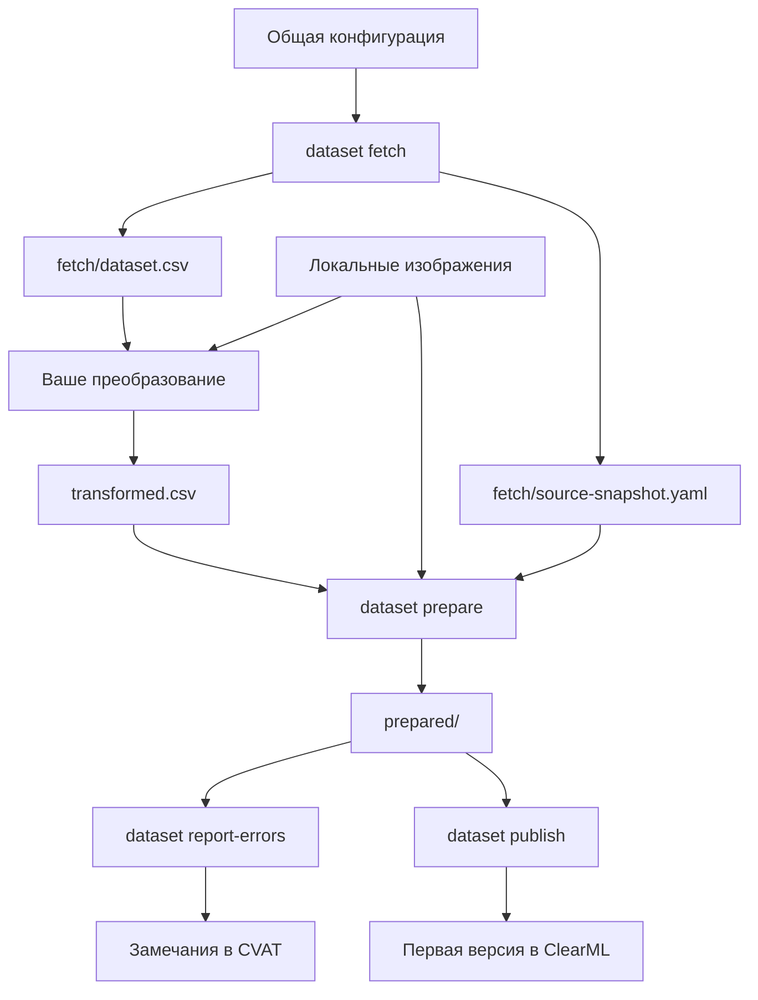
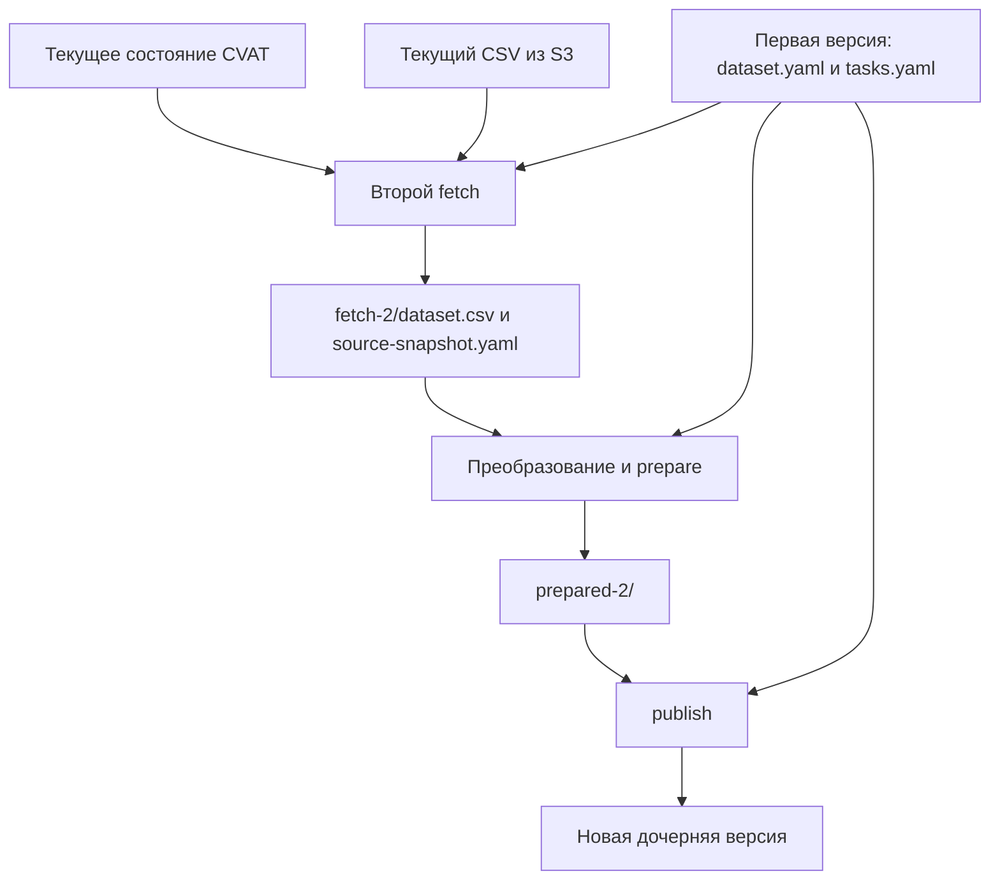

# Управляемый датасет: полный цикл и файлы

В примере датасет `shelves-det` собирается из проекта CVAT `shelves` (источник `cvat`) и CSV-объекта S3 (источник `extra`). Рабочие файлы лежат в `output/`, изображения — в `~/data/images/`. Команды `dataset` читают определение из общей конфигурации и используют выбранную личную конфигурацию. Пути и имена версий в примере можно заменить своими. [Описание датасета](commands/dataset.md#описание-датасета-в-общей-конфигурации) · [Выбор конфигурации и команды](../cveta2/composition/managed.py)



## 01. Описать датасет

В общей конфигурации добавьте `datasets.shelves-det` с назначением ClearML, URL реестра классов и двумя источниками. Укажите ID проекта в `projects.shelves.id`. В личном `config.yaml` выберите общую конфигурацию и задайте локальные пути к изображениям. Путь к личному файлу по умолчанию — `~/.config/cveta2/config.yaml`. Путь к общей конфигурации выбирается через `--global-config`, `CVETA2_GLOBAL_CONFIG` или `global_config`. [Пример YAML](commands/dataset.md#описание-датасета-в-общей-конфигурации) · [Загрузка конфигурации](../cveta2/adapters/config/project.py)

```bash
cveta2 dataset list
cveta2 dataset show shelves-det
```

`list` перечисляет определения. `show` запрашивает последнюю версию по проекту и имени в ClearML. Если есть версия с `dataset.yaml`, SDK получает локальную копию этого файла в своём кэше. Рабочих каталогов в `output/` эти команды не создают. [Операции list и show](../cveta2/composition/managed.py) · [Получение метаданных версии](../cveta2/adapters/clearml/bundle.py)

## 02. Первая выгрузка

```bash
cveta2 dataset fetch shelves-det --output-dir output/fetch
```

Команда читает определение, реестр классов, последнюю версию в ClearML, состояние задач CVAT и CSV-объект S3. В примере версий ещё нет. Задачи из списка игнорирования пропускаются. Изображения не скачиваются. Временный каталог `output/.cveta2-source-*/` содержит те же файлы, что итоговый `output/fetch/`. Команда создаёт новый итоговый каталог и добавляет снимок последним. [Сбор источников](../cveta2/application/use_cases/managed_sources.py) · [Запись файлов выгрузки](../cveta2/adapters/files/managed_sources.py)

| Каталог | Файлы | Что вы получаете |
|---|---|---|
| `output/fetch/` | `dataset.csv` | Объединённые строки текущих аннотаций с полями происхождения `source_id`, `source_project_id`, `source_task_id`, `source_frame_id`, `source_row_id`. |
| `output/fetch/` | `source-snapshot.yaml` | Реестр классов, идентификаторы и состояние источников, исходные таблицы, сведения о задачах, объекте S3 и родителе. `parent_id` равен ID последней версии ClearML, даже неуправляемой, или `null`, если версий нет. |
| `output/fetch/sources/cvat/` | `dataset.csv`, `obsolete.csv`, `in_progress.csv`, `deleted.csv` | Четыре результата разбиения строк CVAT. |
| `output/fetch/sources/extra/` | `dataset.csv`, `obsolete.csv`, `in_progress.csv`, `deleted.csv` | Первая таблица содержит текст входного CSV, остальные — только заголовок. |

[Состав снимка](../cveta2/domain/managed/models.py) · [Результат fetch](../cveta2/composition/managed.py) · [Значение четырёх таблиц](dataset-format.md#файлы-полной-выгрузки)

## 03. Скачать изображения

```bash
cveta2 s3-sync -p "Retail shelves"
```

Для проекта CVAT `s3-sync` читает настройки проекта и личного кэша, определяет корень синхронизации и скачивает недостающие объекты S3 в кэш изображений. Например, объект может появиться как `~/data/images/2026-02/shelf_0009.jpg`. Для источника `extra` скопируйте исходные изображения в разрешённый локальный каталог, например `~/data/images/extra/extra-3.png`. Набор файлов в этих каталогах определяется вашими источниками. Пути должны попадать под `cache.images_root` или под локальные корни проектов-источников. [Команда синхронизации](commands/s3-sync.md) · [Реализация синхронизации](../cveta2/interfaces/commands/s3_sync.py) · [Сбор разрешённых корней](../cveta2/composition/managed.py)

## 04. Преобразовать CSV

```bash
python transform.py output/fetch/dataset.csv ~/data/images output/transformed.csv
```

В этом примере ваш `transform.py` читает `output/fetch/dataset.csv` и файлы изображений под `~/data/images/`, заполняет абсолютный `image_path` и сохраняет `output/transformed.csv`. Сохраните поля происхождения для доставки замечаний. Распределение новых изображений по `train`, `val` и `test` задаёте вы. Пустые split можно заполнить после подготовки. [Пример transform.py](workflows.md#управляемый-датасет) · [Применение split и привязка замечаний](../cveta2/application/use_cases/managed_preparation.py)

## 05. Подготовить каталог

```bash
cveta2 dataset prepare shelves-det output/transformed.csv \
  --source output/fetch --output-dir output/prepared
```

Команда получает реестр классов и родителя ClearML, собирает классы и разрешённые корни. Затем читает `output/transformed.csv` и `output/fetch/source-snapshot.yaml`, сверяет снимок с родителем, проверяет пути и доступность корней S3. По локальным файлам из `image_path` она определяет хеш содержимого, применяет решения о пересечениях, переносит опубликованные split и проверяет изображения и аннотации. При наличии неуправляемой версии используйте `--first`, чтобы начать управляемую историю без родителя. [Сбор метаданных](../cveta2/composition/managed.py) · [Порядок проверок](../cveta2/application/use_cases/managed_preparation.py)

Команда сначала записывает файлы во временный `output/.cveta2-managed-*/`. Затем они появляются в новом `output/prepared/`, который должен находиться вне `output/fetch/`. Последним появляется `preparation.json`. [Запись подготовки](../cveta2/adapters/files/managed_preparation.py)

| Файл в `output/prepared/` | Содержимое | Когда записан |
|---|---|---|
| `transformed.csv`, `source-snapshot.yaml` | Точные копии преобразованного CSV и снимка. | При готовой и заблокированной подготовке |
| `report.json` | Итог проверки, `ready`, `blockers`, `pending`, сведения о split и замечаниях. | В обоих случаях |
| `broken-images.csv` | Все строки изображений с отклонёнными строками после решений о пересечениях и переноса split. | В обоих случаях |
| `dataset.csv` | Очищенные строки. | Если `ready` |
| `dataset.yaml` | Классы, корни изображений и управляемые метаданные с назначенными split. | Если `ready` |
| `tasks.yaml` | Список задач и снимок источников с хешами изображений. | Если `ready` |
| `preparation.json` | Версия формата, имя датасета, родитель, замечания, признаки `ready`, `clean`, `first`. | В обоих случаях |

[Формирование отчёта и публикуемых файлов](../cveta2/application/use_cases/managed_preparation.py) · [Формат каталога](dataset-format.md#dataset-prepare)

## 06. Заполнить split

Если `output/prepared/report.json` перечисляет незаполненные split в `pending`, отредактируйте `output/prepared/dataset.csv`. В `dataset.yaml` можно, например, изменить отметку исключённого класса. Публикация заново проверяет текущие файлы и пересчитывает `tasks.yaml` и управляемые поля `dataset.yaml`. Остальные файлы шага 05 остаются в том же каталоге. [Проверка текущих файлов](../cveta2/application/use_cases/managed_publication.py)

## 07. Доставить замечания в CVAT

```bash
cveta2 dataset report-errors output/prepared
```

Шаг необязателен и доступен при заблокированной подготовке. Команда сравнивает текущий сервер CVAT, родителя ClearML и источники со снимком. Задача, завершённая после выгрузки, останавливает команду. Для подходящего замечания команда сверяет кадр и уже существующие issue, сохраняет намерение отправить замечание и после доставки обновляет запись. Если этот шаг пропустить, доставку выполнит `publish`. [Проверка свежести](../cveta2/application/use_cases/managed_publication.py) · [Доставка замечаний](../cveta2/application/use_cases/managed_feedback.py)

| Каталог | Какие файлы используются |
|---|---|
| `output/prepared/` | Читаются `preparation.json`, `transformed.csv`, `source-snapshot.yaml`, `report.json`. Если есть публикуемые файлы, проверяется комплект `dataset.csv`, `dataset.yaml`, `tasks.yaml`. `broken-images.csv` не нужен. При наличии прежнего `feedback.json` учитываются его записи. |
| `managed-feedback/` рядом с личным `config.yaml` | Общий для подготовок из одного снимка файл `<SHA-256 source-snapshot.yaml>.json`. При сохранении используется временный `.cveta2-feedback-*`. Если замечаний и прежних записей нет, файл создавать не требуется. |
| Кэш SDK ClearML | При наличии родителя с метаданными SDK получает его `dataset.yaml`. |

[Чтение файлов подготовки](../cveta2/adapters/files/managed_preparation.py) · [Файлы записей доставки](../cveta2/adapters/files/managed_feedback.py) · [Путь к общей записи](../cveta2/composition/managed.py)

## 08. Опубликовать первую версию

```bash
cveta2 dataset publish output/prepared
```

После проверки свежести, как на шаге 07, команда копирует публикуемые файлы во временный каталог и проверяет именно эту копию. Читает изображения по `image_path`, проверяет классы, разрешённые корни и split. Затем пересчитывает служебные данные, доставляет замечания, ещё раз сверяет источники и родителя и публикует версию. Если доставка не удалась, новую версию не создаёт. [Порядок публикации](../cveta2/application/use_cases/managed_publication.py)

| Каталог или хранилище | Какие файлы используются |
|---|---|
| `output/prepared/`, кэш SDK, корни изображений, `managed-feedback/` | Входы шага 07 и каждый локальный файл из `image_path`. Перезаписываются `dataset.yaml` и `tasks.yaml` до доставки замечаний. |
| Системный временный каталог `cveta2-managed-publish-*/` | `dataset.csv`, `dataset.yaml`, `tasks.yaml`. При замене YAML здесь и в `output/prepared/` используются `.dataset.yaml.tmp` и `.tasks.yaml.tmp`. |
| Новая версия в ClearML | Три файла — `dataset.csv`, `dataset.yaml`, `tasks.yaml`. Изображения остаются по путям, указанным в датасете. Если версий ещё не было или использован `--first`, опубликованная версия начинает историю без родителя. |

[Копирование и замена файлов](../cveta2/adapters/files/managed_preparation.py) · [Создание и финализация версии](../cveta2/adapters/clearml/bundle.py)

## 09. Выгрузить источники ещё раз

```bash
cveta2 dataset fetch shelves-det --output-dir output/fetch-2
```

Повторная выгрузка получает из кэша SDK родительский `dataset.yaml` и, для управляемой версии, снимок из `tasks.yaml`. Она заново запрашивает в CVAT актуальный список задач и метки. Для подходящего источника использует сохранённые строки неизменившейся завершённой задачи; остальные нужные задачи перечитывает. Изменение реестра классов, сервера или организации CVAT либо `--refresh` отключает такое переиспользование. Из S3 каждый раз читается сам CSV-объект. [Правила переиспользования](../cveta2/application/use_cases/managed_sources.py) · [Чтение опубликованного снимка](../cveta2/adapters/clearml/managed_sources.py)



Временный `output/.cveta2-source-*/` и итоговый `output/fetch-2/` содержат тот же набор, что на шаге 02. В корне лежат `dataset.csv` и `source-snapshot.yaml`, в каждом из `sources/cvat/` и `sources/extra/` — `dataset.csv`, `obsolete.csv`, `in_progress.csv`, `deleted.csv`. В снимке теперь указан ID опубликованной версии и списки `fetched` и `reused` по источнику CVAT. Ключ `skipped` записывается в снимок, только если пропущена хотя бы одна задача без данных. [Поля источника](../cveta2/domain/managed/models.py) [Формирование снимка](../cveta2/application/use_cases/managed_sources.py) · [Файлы выгрузки](../cveta2/adapters/files/managed_sources.py)

## 10. Опубликовать обновление

```bash
python transform.py output/fetch-2/dataset.csv ~/data/images output/transformed-2.csv
cveta2 dataset prepare shelves-det output/transformed-2.csv \
  --source output/fetch-2 --output-dir output/prepared-2
cveta2 dataset publish output/prepared-2
```

Докачайте новые изображения в те же корни, что на шаге 03. Преобразование читает новый CSV и пишет `output/transformed-2.csv`. Подготовка использует новый снимок и родительский `dataset.yaml` из кэша SDK. Ранее опубликованное содержимое сохраняет split даже при переименовании изображения. Перед публикацией проверьте `pending` и при необходимости повторите шаг 06. [Перенос split](../cveta2/domain/managed/policies.py) · [Проверка split при публикации](../cveta2/application/use_cases/managed_publication.py)

Временный каталог подготовки и новый `output/prepared-2/` содержат `transformed.csv`, `source-snapshot.yaml`, `broken-images.csv`, `report.json`, `preparation.json` и, при готовности, `dataset.csv`, `dataset.yaml`, `tasks.yaml`. Публикация повторно использует каталоги шага 08 и файл в `managed-feedback/`, выбранный по хешу **нового** снимка. Из временной копии в дочернюю версию ClearML попадают только три публикуемых файла. Сравнить версии можно через `cveta2 dataset diff output/prepared output/prepared-2`. [Запись подготовки](../cveta2/adapters/files/managed_preparation.py) · [Родитель и сравнение версий](../cveta2/composition/managed.py) · [Публикация](../cveta2/application/use_cases/managed_publication.py)
